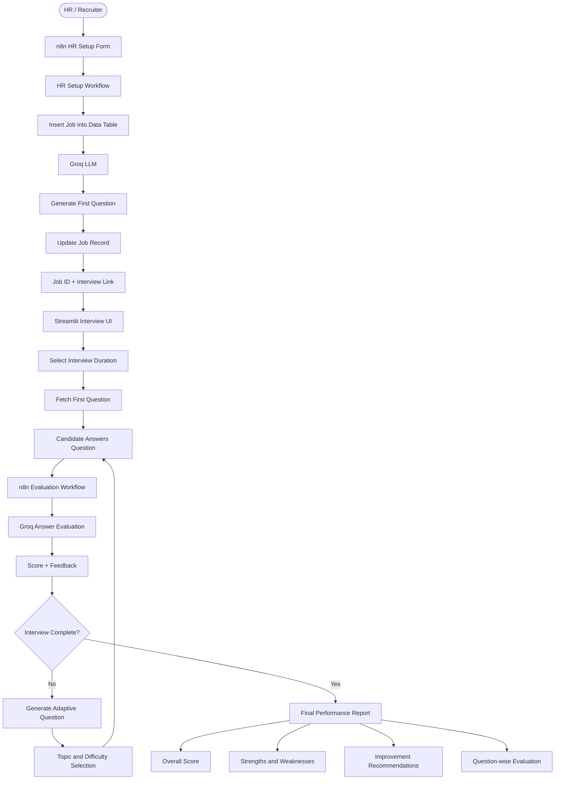

# 🎯 Adaptive Interview Simulator — AI-Powered Technical Interviews

> An end-to-end **AI-powered adaptive interview platform** built with **Python**, **Streamlit**, **n8n**, and **Groq LLMs** — featuring intelligent follow-up questions, automated answer evaluation, time-based interviews, and performance reporting.


---

## 📌 Overview

**Adaptive Interview Simulator** is an AI-driven technical interview application that dynamically generates interview questions based on the candidate's responses.

Unlike traditional interview platforms that use a fixed set of questions, this system evaluates each answer and intelligently decides whether to:

- Ask a deeper follow-up question.
- Simplify or clarify the current concept.
- Switch to another technical topic.
- Increase the difficulty based on performance.
- Skip a topic when the candidate cannot answer.

The platform also supports automated HR job setup, timed interview sessions, question limits, answer evaluation, and a final performance report.

### Application Flow

```text
HR Job Setup Form
       |
       v
n8n Workflow Automation
       |
       v
Groq LLM Generates First Question
       |
       v
Job ID Generated and Stored
       |
       v
Start Your Interview
       |
       v
Streamlit Interview Interface
       |
       v
Candidate Submits Answer
       |
       v
Groq Evaluates Answer
       |
       v
Adaptive Follow-up Question
       |
       v
Interview Completion
       |
       v
Final Performance Report
```

---

## 🧰 Tech Stack

| Layer | Technology | Role |
|---|---|---|
| Programming | **Python** | Core application logic |
| Frontend | **Streamlit** | Interactive interview interface |
| Automation | **n8n** | Workflow orchestration and API integration |
| AI Inference | **Groq API** | Fast LLM inference |
| Language Model | **GPT-OSS-120B** | Question generation and answer evaluation |
| Storage | **n8n Data Tables** | Job information and generated questions |
| HTTP Integration | **Python Requests** | Communication with n8n webhooks |
| Configuration | **python-dotenv** | Environment variable management |
| Deployment | **Render** | Cloud hosting for Streamlit |
| Version Control | **Git & GitHub** | Source code management |

---

## 🔄 System Architecture



---

## ⚙️ n8n Workflow Orchestration

The system uses three main n8n workflows.

### Workflow 1 — HR Job Setup

**Purpose:** Collect job requirements and generate the first interview question.

```text
Form Submission
      |
      v
Edit Fields
      |
      v
Data Table - Insert Row
      |
      v
HTTP Request - Groq API
      |
      v
Edit Fields - Extract Question
      |
      v
Data Table - Update Row
      |
      v
Form Ending - Job ID + Interview Link
```

HR provides:

- Job Role
- Job Description
- Seniority Level

The workflow stores the job information, generates the first technical question using Groq, and associates it with a unique Job ID.

### Workflow 2 — Interview Initialization

**Purpose:** Retrieve the first question for a selected job.

```text
Streamlit
    |
    v
POST /adaptive-interview
    |
    v
n8n Webhook
    |
    v
Data Table - Get Row
    |
    v
Respond to Webhook
    |
    v
First Question Displayed
```

Example request:

```json
{
  "job_id": 24
}
```

Example response:

```json
{
  "found": true,
  "job_role": "Python Developer",
  "seniority": "Fresher",
  "first_question": "What is the difference between a list and a tuple in Python?"
}
```

### Workflow 3 — Adaptive Answer Evaluation

**Purpose:** Evaluate candidate answers and generate context-aware follow-up questions.

```text
Candidate Answer
      |
      v
POST /evaluate-answer
      |
      v
n8n Webhook
      |
      v
HTTP Request - Groq LLM
      |
      v
Edit Fields - Parse AI Response
      |
      v
Respond to Webhook
      |
      v
Streamlit Displays Next Question
```

Example response:

```json
{
  "score": 7,
  "feedback": "The answer is correct but lacks practical examples.",
  "next_question": "When would you prefer a tuple instead of a list?",
  "next_topic": "Lists and Tuples",
  "reason": "To evaluate the candidate's understanding of practical use cases."
}
```

---

## 🧠 Adaptive Interview Logic

The AI interview adapts to the candidate's knowledge and responses.

### 1. Intelligent Follow-up Questions

Correct answers lead to deeper or more challenging questions.

Incomplete answers can lead to clarification questions.

### 2. Topic Switching

The system targets a maximum of **three follow-up questions per topic** after the initial question.

After the topic limit is reached, the next question should move to another relevant technical topic.

### 3. Handling Unknown Answers

If a candidate responds with:

- "I don't know"
- "No idea"
- "Skip"
- "Pass"

The system requests a switch to another technical topic instead of repeatedly questioning the candidate about the skipped concept.

### 4. Adaptive Difficulty

The LLM uses the candidate's previous answers, current topic, job role, and seniority to select suitable follow-up questions.

### 5. Explainable Follow-ups

Each adaptive question includes a brief explanation under:

**Why this follow-up?**

This helps users understand the reasoning behind the next question.

---

## ⏱️ Interview Duration and Question Limits

Candidates can choose their preferred interview duration before starting.

| Interview Duration | Maximum Questions |
|---|---:|
| 15 Minutes | 10 |
| 30 Minutes | 25 |
| 45 Minutes | 35 |
| 60 Minutes | 50 |

The interview ends when:

1. The selected time limit expires.
2. The maximum question count is reached.
3. The candidate manually finishes the interview.

The countdown timer remains active throughout the interview.

---

## 📊 Interview Performance Report

After completing an interview, the application generates a performance report using the recorded evaluation results.

### Overall Performance

The overall score is calculated from the individual question scores.

Example:

```text
Interview Performance Report

Overall Performance
        7.2/10
```

### Competency Scores

The report interface contains four competency categories:

| Competency | Description |
|---|---|
| Technical Knowledge | Understanding of technical concepts |
| Problem Solving | Ability to approach and solve problems |
| Concept Clarity | Accuracy and clarity of explanations |
| Communication | Ability to express technical knowledge |

**Note:** Independent AI-generated competency scoring is a planned enhancement. The current report uses available per-question evaluation scores rather than claiming separate verified competency assessments.

### Pros / Strengths

Highlights strong answers and topics where the candidate performed well.

### Cons / Areas to Improve

Identifies weaker answers and concepts requiring additional practice.

### Improvement Recommendations

Provides guidance based on questions where the candidate received lower evaluation scores.

### Question-wise Evaluation

Each question is available in an expandable section containing:

- Interview question
- Candidate answer
- Evaluation score
- AI feedback

---

## 📁 Project Structure

```text
adaptive_interview/
│
├── app.py
├── app_backup.py
├── config.py
├── requirements.txt
├── .env
│
├── pages_ui/
│   ├── __init__.py
│   ├── interview.py
│   ├── report.py
│   └── error_page.py
│
├── services/
│   ├── __init__.py
│   ├── api.py
│   └── session.py
│
└── utils/
    ├── __init__.py
    └── helpers.py
```

### Module Responsibilities

| Module | Responsibility |
|---|---|
| `app.py` | Main application entry point |
| `config.py` | Configuration and question limits |
| `pages_ui/interview.py` | Interview UI and interaction |
| `pages_ui/report.py` | Performance report interface |
| `pages_ui/error_page.py` | Interview termination screen |
| `services/api.py` | n8n webhook communication |
| `services/session.py` | Streamlit session-state management |
| `utils/helpers.py` | Shared helper functions |
| `app_backup.py` | Backup of the earlier application |

---

## 🔐 Environment Variables

Create a `.env` file in the project root.

```env
N8N_WEBHOOK_URL=https://YOUR-N8N-DOMAIN/webhook/adaptive-interview

N8N_EVALUATION_URL=https://YOUR-N8N-DOMAIN/webhook/evaluate-answer
```

Replace `YOUR-N8N-DOMAIN` with the domain of your active n8n instance.

The Groq API key is configured securely in n8n credentials.

**Never commit API keys, `.env` files, or other secrets to GitHub.**

---

## 🚀 Local Setup

### 1. Clone the Repository

```bash
git clone https://github.com/YOUR_USERNAME/YOUR_REPOSITORY.git
cd YOUR_REPOSITORY
```

### 2. Create a Virtual Environment

```bash
python -m venv venv
```

Activate on Windows PowerShell:

```powershell
.\venv\Scripts\Activate.ps1
```

### 3. Install Dependencies

```bash
pip install -r requirements.txt
```

### 4. Configure Environment Variables

Create `.env` and add the correct n8n production webhook URLs.

### 5. Start Streamlit

```bash
streamlit run app.py
```

Open:

http://localhost:8501

### 6. Configure n8n

Make sure:

- All required workflows are imported and published.
- The Groq API credential is valid.
- The `interview_jobs` Data Table exists.
- Data Table references are correctly configured.
- Production webhook URLs match `.env`.
- The HR form's Start Interview link points to the correct Streamlit URL.

---

## ☁️ Deployment — Render

The Streamlit application is deployed using Render.

**Live Application:**

https://adaptive-interview-refc.onrender.com/

The deployed application communicates with published n8n workflows through HTTPS webhooks.

### Render Configuration

**Build Command:**

```bash
pip install -r requirements.txt
```

**Start Command:**

```bash
streamlit run app.py --server.address 0.0.0.0 --server.port $PORT --server.headless true
```

Configure these environment variables in Render:

```text
N8N_WEBHOOK_URL
N8N_EVALUATION_URL
```

Both must point to the currently active n8n account.

The HR workflow's interview link must use the deployed Render URL instead of `localhost:8501`.

---

## 🛡️ Error Handling

The application includes interview termination handling for fatal AI evaluation failures.

Possible failures include:

- AI service unavailability
- API quota exhaustion
- Invalid AI credentials
- Invalid API responses
- Network or server errors

When evaluation cannot continue, the application terminates the current interview.

```text
INTERVIEW TERMINATED

AI Evaluation Is Temporarily Unavailable

The interview has ended.
All current interview progress has been discarded.

Please start a new interview from Question 1
when the service becomes available.
```

The application does not preserve the interrupted interview for later resumption.

---

## 🧪 Example Interview

**Job Role:** Python Developer

**Seniority:** Fresher

**Question 1:**

What is the difference between a list and a tuple in Python?

**Candidate Answer:**

A list is mutable, while a tuple is immutable.

**AI Evaluation:**

```json
{
  "score": 7,
  "feedback": "Correct understanding of mutability, but the answer could include practical examples.",
  "next_question": "When would you prefer using a tuple over a list?",
  "next_topic": "Lists and Tuples",
  "reason": "To assess understanding of practical applications."
}
```

The system continues generating adaptive questions until the selected interview limit or completion condition is reached.

---

## ✅ Project Status

| Feature | Status |
|---|---|
| HR Job Setup Form | ✅ Implemented |
| Automatic Job ID Generation | ✅ Implemented |
| AI-Generated First Question | ✅ Implemented |
| Streamlit Interview Interface | ✅ Implemented |
| Groq LLM Integration | ✅ Implemented |
| Answer Evaluation | ✅ Implemented |
| Adaptive Follow-up Questions | ✅ Implemented |
| Duration-Based Question Limits | ✅ Implemented |
| Countdown Timer | ✅ Implemented |
| Skip / Don't Know Handling | ✅ Implemented |
| Follow-up Reason Explanation | ✅ Implemented |
| Question-wise Evaluation | ✅ Implemented |
| Overall Performance Score | ✅ Implemented |
| Strengths and Weaknesses | ✅ Implemented |
| Improvement Recommendations | ✅ Implemented |
| AI Service Error Handling | ✅ Implemented |
| Modular Python Architecture | ✅ Implemented |
| Render Deployment | ✅ Implemented |
| Independent AI Competency Scoring | 🔜 Planned |
| Persistent Interview History | 🔜 Future Enhancement |

---

## 🎯 Key Learning Outcomes

This project demonstrates practical experience with:

- Building interactive Python applications using Streamlit.
- Designing workflow automation with n8n.
- Integrating large language models through APIs.
- Developing adaptive question-generation logic.
- Implementing answer evaluation and structured JSON responses.
- Working with webhooks and HTTP requests.
- Managing interview sessions and countdown timers.
- Organizing Python applications into modular components.
- Deploying AI-powered applications to cloud hosting.
- Handling API errors and external service limitations.

---

## 👨‍💻 Author

**Sajid Patel**

Aspiring Generative AI Developer | Python Developer

**Technologies:** Python • Streamlit • n8n • Groq • LLMs • REST APIs

---

### n8n Workflow Setup

The `n8n/` folder contains sanitized workflow JSON files that you can import into your own n8n account. Configure your own Groq API credentials, and create or reconnect the required `interview_jobs` Data Table after import. Update webhook URLs and deployment environment variables for your own n8n instance. No API keys or passwords are included in the public workflow files.
